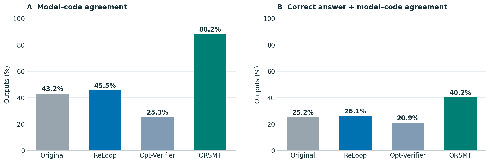
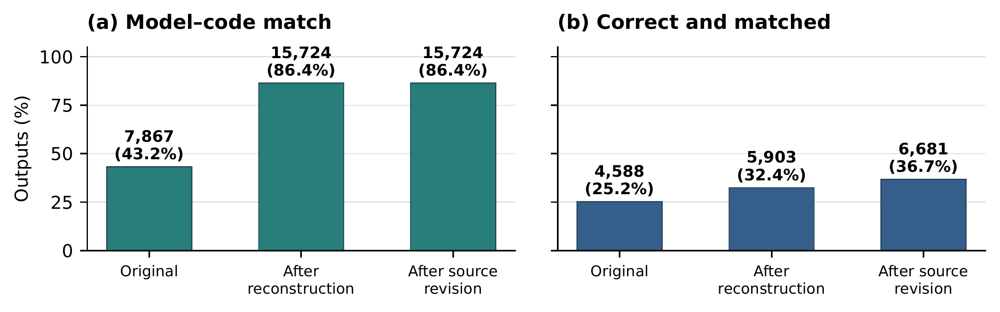
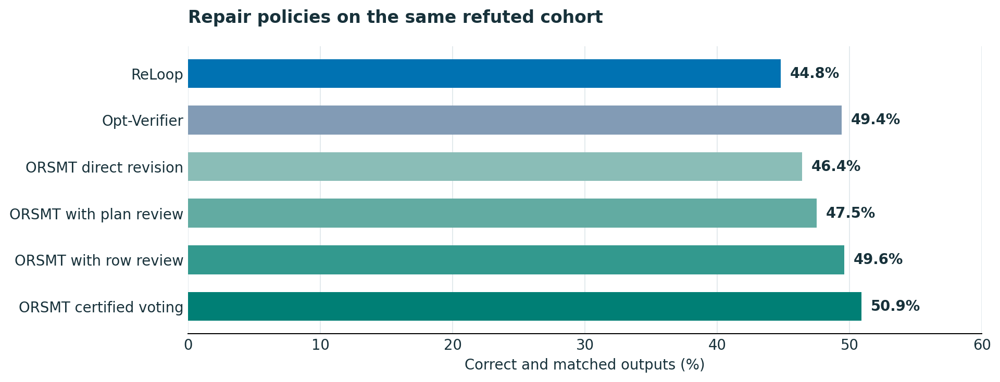
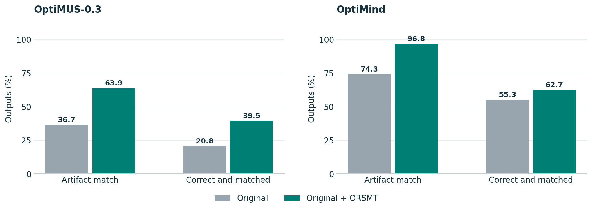
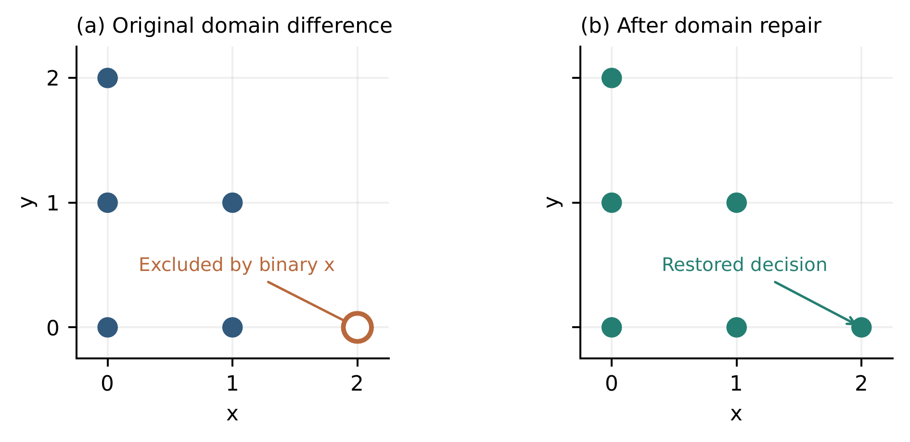
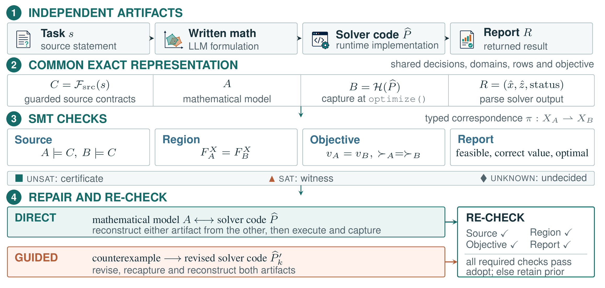

<div align="center">

# ORSMT

### Semantic Verification and Repair in LLM-Based Optimization

**Verify semantic agreement. Locate discrepancies. Repair and recheck.**

[Results](#-experimental-results) · [Visual examples](#-visual-examples) · [Method](#-how-it-works) · [Quick start](#-quick-start) · [Citation](#-citation)

</div>

A solver can return the expected optimum while its program implements a different feasible region. Written mathematics and code can also agree while omitting the same source requirement. **ORSMT** uses exact SMT queries to expose these discrepancies, produce concrete counterexamples, and verify repaired artifacts before adoption.

**Paper:** *ORSMT: Unleashing the Potential of Satisfiability Modulo Theories for Semantic Verification and Repair in LLM-Based Optimization*<br>
**Authors:** Rui Zhang¹, Chenyu Zhou², Jianghao Lin², Yaoxin Wu³, Dongdong Ge², Wen Song¹<br>
¹ Shandong University · ² Shanghai Jiao Tong University · ³ Eindhoven University of Technology

## 📊 Experimental results

### Stronger agreement and more correct, matched outputs

The full pipeline raises **model–code agreement from 43.2% to 88.2%** and the share of outputs that are **both correct and matched from 25.2% to 40.2%**. An answer is correct under the benchmark evaluator; a match requires the exact semantic relation between written mathematics and captured code.

[](assets/results/main-results.svg)

*Full-population pipeline outcomes across six generators, with protected selection. The two plotted rates use all assigned outputs; unresolved cases remain in the denominator. [Source table and protocol](docs/paper-results/README.md#full-population-pipeline-comparison).*

### Reconstruction and source revision in the original paper figure

[](assets/overleaf/repair-progression.pdf)

*Original vector artwork from Overleaf. This ablation is measured **before protected selection**: its 86.4% match rate and 36.7% correct-and-matched rate are distinct from the protected full-pipeline rates of 88.2% and 40.2% above. [Provenance and protocol](docs/paper-results/README.md#reconstruction-and-source-revision).*

### Repair policies and review ablations

On the fixed original model–code refutations, **five-candidate certified voting reaches 50.9% correct-and-matched outputs**, compared with **44.8% for ReLoop** and **49.4% for Opt-Verifier**.

[](assets/results/controlled-repair.svg)

*The same 1,905 original refutations and 14B reviser are used. Voting uses five candidates; review policies have their own call costs. This policy comparison is separate from the manuscript's single-round source-revision/reconstruction experiment. [Source table, costs and protocol](docs/paper-results/README.md#controlled-repair-comparison).*

### Improvements when integrated into existing systems

ORSMT improves artifact agreement in both hosts. **OptiMUS-0.3** increases correct-and-matched outputs from **20.8% to 39.5%**. **OptiMind** increases artifact agreement from **74.3% to 96.8%**, while correct-and-matched outputs rise from **55.3% to 62.7%**.

[](assets/results/host-integration.svg)

*Each host is evaluated on the same assigned problems. OptiMUS uses the exact model–code relation; OptiMind uses exact scalar extraction or reference-blind multi-auditor checks and rechecks reconstructions. [Source table and protocol](docs/paper-results/README.md#host-integration).*

The figures report experiments from the manuscript. The public repository contains the core implementation and frozen pre-repair audit data; the baseline and host runs are documented results, with their table snapshots provided for inspection. [Release coverage and reproduction](docs/reproduction.md).

## 🔎 Visual examples

### 1. A wrong proportion constraint changes the feasible region

In the released **NL4Opt-67** trace, at least 40% of all delivery trips must use the old company. With `x` new-company trips and `y` old-company trips, the written formulation uses `y − x ≥ 0.4`; the program correctly uses `3y − 2x ≥ 0`.

[](assets/results/shipping-counterexample.svg)

The witness **`(x, y) = (15, 10)`** satisfies the program and the reviewed formal reference, but violates the written proportion row. After source review, the **written model is repaired**, the code stays unchanged, and the pair changes from **`REFUTED` to `CERTIFIED`**. The reported optimum remains **580**, illustrating why objective agreement alone misses the discrepancy.

*The plot evaluates the stored original, captured and revised constraints using exact rational arithmetic and shows only feasible integer points in the displayed window. The vertical display limit is not a model bound. The revision in this stored worked trace is manually reviewed, with zero LLM calls; it is not counted as an automated repair trial. [Original trace and counterexample](data/worked_trace/nl4opt67/summary.json) · [Revision](data/worked_trace/nl4opt67/07_proposed_revision.json) · [Reverification](data/worked_trace/nl4opt67/08_reverification.json).*

### 2. The same optimum can hide an incorrect variable domain

In the manuscript's **ComplexOR-3** example, the written model maximizes `x + y` subject to `x + y ≤ 2`, with nonnegative integer variables. The code changes `x` to binary. Both admit the reported optimum **`(0, 2)`**, with value **2**, but only the written model admits **`(2, 0)`**.

[](assets/overleaf/domain-case.pdf)

The original Overleaf figure shows domain repair. Sequential removal of two duplicate constraints also preserves equivalence of the generated pair. **The generated model still has optimum 2; the original assignment problem has reference answer 3.** Restoring source fidelity requires participant–car assignment variables and constraints. [Full manuscript case and interpretation](docs/paper-results/source_tables/appendix_cases_detailed.tex).

## 🧠 How it works

[](assets/overleaf/method.pdf)

*Exported from the figure source actually referenced by the Overleaf manuscript, with its original formulas and Times/Helvetica font configuration. Source checks require admitted source contracts; the recheck gate applies the checks required by the active policy. Objective-value agreement is checked separately from preference-order agreement. [Exact source and export record](assets/overleaf/README.md).*

**Translate → check → diagnose → repair → recheck.** ORSMT compares feasible regions, objective preferences and values, and reported solutions. Counterexamples localize the discrepancy to constraints or domains. A selected artifact supports direct reconstruction, or source-guided revision proposes a correction; required relation checks run again before adoption.

An LLM may propose a translation or repair. Verification verdicts come from the formal checks. Unsupported translations, ambiguous correspondences and solver unknowns remain unresolved. [Interfaces and scope](docs/reproduction.md#-interfaces-and-documentation).

## 🚀 Quick start

Use **Python 3.10+**. The commands below use Bash on Linux, macOS, or Git Bash on Windows.

```bash
git clone https://github.com/ZRay1213/ORSMT.git
cd ORSMT
python -m venv .venv
source .venv/bin/activate
python -m pip install -e .
python examples/brownie_trace.py > brownie_report.json
```

This small example uses Z3 and needs no API key, GPU or Gurobi license. Open `brownie_report.json` to inspect verdicts, implicated constraints and witnesses. Its `profile.end_to_end` is `REFUTED`: the written model and runtime model agree, but both violate a source obligation.

For tests, native adapters, Gurobi replay, repair planning and the frozen data audit, see the [reproduction guide](docs/reproduction.md).

## 📖 Citation

For this code and data release:

```bibtex
@misc{zhang2026orsmt,
  title={ORSMT: Unleashing the Potential of Satisfiability Modulo Theories for Semantic Verification and Repair in LLM-Based Optimization},
  author={Rui Zhang and Chenyu Zhou and Jianghao Lin and Yaoxin Wu and Dongdong Ge and Wen Song},
  year={2026},
  howpublished={Code and data repository},
  url={https://github.com/ZRay1213/ORSMT}
}
```

## ✉️ Contact

Rui Zhang: [202300190245@mail.sdu.edu.cn](mailto:202300190245@mail.sdu.edu.cn).
